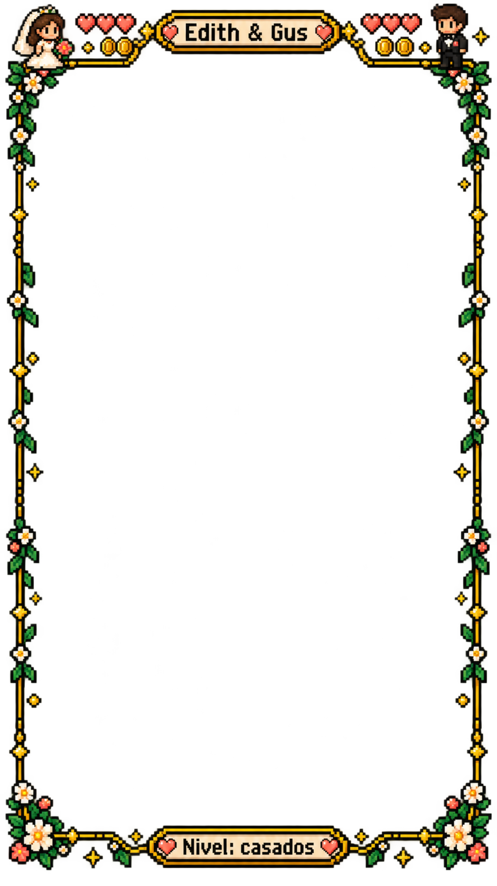

# Fotomatón web

[](https://github.com/micoach-agustin/fotomaton-web/actions/workflows/ci.yml)
[](LICENSE)

**Standalone event photobooth · React + TypeScript + Vite · Bring your own storage**

Fotomatón independiente para bodas y eventos, extraído del fotomatón de Edith y Gus. Haz fotos o vídeos desde la cámara del navegador, añade marcos y accesorios y guarda el resultado en tu dispositivo.

Incluye **18 marcos PNG** (9 diseños con versión vertical y horizontal), **11 imágenes de accesorios** (12 combinaciones) y **7 controles ilustrados**. Los archivos están dentro de este repositorio; no se descargan de un servicio privado.

<p>
  
  
  
</p>

## Ponerlo en marcha

Necesitas Node.js 20.19 o posterior; se recomienda Node.js 22 LTS.

```sh
git clone https://github.com/micoach-agustin/fotomaton-web.git
cd fotomaton-web
npm ci
cp .env.example .env.local
npm run dev
```

Abre la URL que muestra Vite. La cámara funciona en `localhost` y, cuando lo publiques, en **HTTPS**. El micrófono se solicita al grabar un vídeo; las fotos no lo necesitan.

La configuración inicial es **local**: no envía fotos, vídeos ni mensajes a ningún servidor. Pulsa Guardar para descargar o compartir una captura. En iPhone/iPad, elige Guardar imagen o Guardar vídeo en la hoja del sistema; el navegador no puede escribir silenciosamente en Fotos. Los mensajes escritos se guardan como `.txt`.

## Configurar tu evento

Edita `.env.local`:

```dotenv
VITE_EVENT_NAME=Mi celebración
VITE_EVENT_ID=mi-celebracion-2026
VITE_STORAGE_MODE=local
VITE_STORAGE_ENDPOINT=
VITE_BASE_PATH=./
```

Reinicia Vite después de cambiarlo. En producción, vuelve a ejecutar la compilación. Las variables `VITE_` son públicas: **nunca pongas claves privadas, contraseñas o tokens de nube en ellas**.

Los nombres y fechas dibujados en algunos PNG pertenecen al diseño original. Cambiar `VITE_EVENT_NAME` cambia los textos de la interfaz; para cambiar el texto del dibujo, sustituye los PNG. Consulta [Personalizar las plantillas](docs/PLANTILLAS.md).

## Subirlo a tu website

```sh
npm run build
```

Sube **el contenido de `dist/`** a tu hosting estático, por ejemplo a `https://tu-dominio.example/fotomaton/`. Incluye todos sus archivos, también `templates/`. No hace falta una base de datos ni un servidor para el modo local. También puedes usar GitHub Pages, Netlify o Vercel con `npm run build` y directorio de salida `dist`.

El `base` relativo predeterminado permite alojarlo en una subcarpeta. Usa la URL con barra final (`/fotomaton/`) o haz que tu servidor redirija a ella. No abras `dist/index.html` haciendo doble clic: sirve la carpeta por HTTP/HTTPS. Para revisarla localmente, ejecuta `npm run preview`.

Para insertarlo en una página existente:

```html
<iframe
  src="https://tu-dominio.example/fotomaton/"
  title="Fotomatón del evento"
  allow="camera; microphone; web-share"
  style="width:100%;height:100dvh;border:0"
></iframe>
```

El sitio contenedor también debe usar HTTPS y permitir cámara/micrófono en su `Permissions-Policy`. En algunos móviles es mejor abrir el fotomatón en una pestaña completa.

## Guardar en tu Drive, AWS S3 u otro servicio

El repositorio no incluye ninguna cuenta, credencial ni conexión preconfigurada. Para recibir copias en la nube necesitas **tu propio backend** y sus credenciales de servidor:

```dotenv
VITE_STORAGE_MODE=endpoint
VITE_STORAGE_ENDPOINT=/api/photobooth
```

El fotomatón enviará únicamente sus capturas y mensajes al endpoint que indiques. La [guía de almacenamiento](docs/ALMACENAMIENTO.md) explica el contrato y la configuración para **Google Drive, AWS S3 y servicios compatibles**. No basta con pegar un enlace de una carpeta de Drive o un bucket: hay que implementar el receptor que autentica y guarda el archivo.

En este modo hay una cola local en IndexedDB: se conservan los envíos pendientes hasta recibir confirmación, se reintentan al volver a abrir la app o recuperar conexión, y hay un botón para reintentar fallos. Guarda también una copia en el teléfono. No hay envío en segundo plano con la página cerrada; borrar los datos del navegador elimina los pendientes. Cada evento y endpoint tienen su cola separada.

## Qué contiene esta extracción

Solo el fotomatón, sus mensajes, la composición de imágenes/vídeos y los recursos que utiliza. No contiene las invitaciones, la web de la boda, el juego, el panel de administración, la app para subir fotos de la galería, listas de invitados, fotos personales, bases de datos ni historial del proyecto original. No tiene dependencias de Azure ni analítica remota.

```text
src/config.ts              Configuración pública del evento
src/photobooth/            Cámara, marcos, accesorios y almacenamiento
public/templates/          PNG originales y manifiesto de archivos
docs/                      Guías de personalización y almacenamiento
scripts/check-public.mjs   Revisión de la exportación pública
```

## Verificar cambios

```sh
npm run check:public
npm test
npm run build
```

La comprobación pública busca archivos ajenos a la extracción, endpoints privados conocidos y patrones habituales de credenciales. No sustituye la revisión de cualquier archivo nuevo que añadas. GitHub Actions ejecuta estas comprobaciones al subir cambios.

Los accesorios se colocan en posiciones fijas en modo vertical; no hay detección facial. La compatibilidad de grabación, audio y guardado depende del navegador. Si la composición de un vídeo no termina a tiempo o el dispositivo no puede procesarla, se conserva el vídeo original; la vista previa muestra el marco, pero ese PNG no estará incrustado en la descarga de ese vídeo.

Código y recursos incluidos bajo [licencia MIT](LICENSE). Puedes descargarlos, modificarlos y usarlos en tus propios websites.
